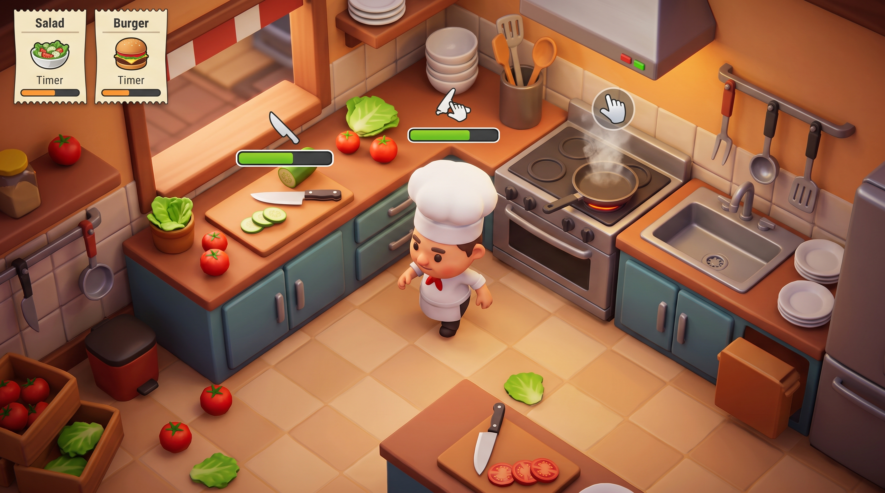

# 🍳 Kitchen Chaos - 3D Cooking Simulation


> A fast-paced 3D kitchen simulation game focusing on robust gameplay architecture, clean code, and decoupled systems.

<div align="center">
  
</div>

## 📖 Overview
**Kitchen Chaos** is a 3D time-management cooking game where players must chop ingredients, cook meals, and serve orders under a tight schedule. 

This project was built to master advanced Unity programming concepts and C# software architecture. While the visual assets and base concept follow [Code Monkey's](https://www.youtube.com/c/CodeMonkeyUnity) excellent curriculum, the core focus of this repository is to demonstrate proficiency in writing clean, scalable, and maintainable game logic.

## ⚙️ Key Technical Implementations (What I Learned)

*   **Finite State Machines (FSM):** Implemented a robust state machine for the player character to handle complex transitions between walking, carrying objects, interacting with counters, and idle states seamlessly.
*   **Event-Driven Architecture:** Decoupled the UI and sound systems from the core gameplay logic using C# Events (`event EventHandler`). This ensures that UI elements only update when necessary, drastically improving performance and code readability.
*   **Scriptable Objects:** Extensively used Scriptable Objects to manage game data (recipes, ingredients, kitchen counters) outside of the codebase, making the game highly modular and designer-friendly.
*   **Interface Implementation:** Used C# Interfaces (e.g., `IHasProgress`, `IKitchenObjectParent`) to allow different systems to communicate cleanly without hard dependencies.

## 🛠️ Tech Stack
*   **Engine:** Unity 3D (URP/Standard)
*   **Language:** C#
*   **Input System:** New Unity Input System
*   **Version Control:** Git & GitHub

## 🚀 How to Play / Install

### 🌐 Play in Browser
Don't want to download the project? You can play the WebGL build directly in your browser:

[](https://abelrahmanmoawad.itch.io/kitchen-chaos)

### 💻 Local Installation
1. Clone the repository:
   ```bash
   git clone [https://github.com/AbdelrahmanMoawad/KitchenChaos.git](https://github.com/AbdelrahmanMoawad/KitchenChaos.git)
